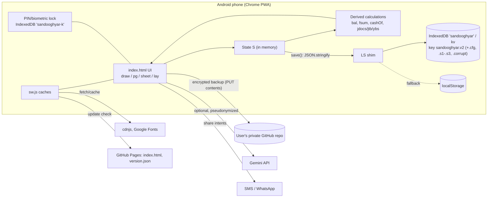

# 00 — README and System Overview: صندوق‌یار (SandooghYar)

| Item | Value |
|---|---|
| Application | **صندوق‌یار** (SandooghYar): manager for Qard al-Hasana (صندوق قرض‌الحسنه, interest-free loan) funds |
| Owner / designer credit | «مؤسسه رنگ خدا» (shown on the splash screen) |
| Current version | `VER='0.40.1'`, defined in `index.html`. `version.json` also says `0.40.1`. |
| Build identifier | git commit `afff760` on `main` of the public repo `rezaebrahimiasl/sandooghyar` (GitHub Pages) |
| Documentation date | 2026-10-22 |
| Source of truth inspected | `index.html` (1,830 lines, ~638 KB), `sw.js`, `manifest.webmanifest`, `version.json`, `HANDOFF.md`, `README.md` in the public repo. Also the private dev source, build script and tests (see §2). |
| Line references | `L###` means a line in the **public** `index.html` at commit `afff760`. The file is mostly one long line per function, so a function name plus line number locates code precisely. |

---

## 1. Purpose and users

- **What it manages.**
  - One or more interest-free loan funds (currently 3 in production use: a family fund and two mosque funds).
  - The people and members (اعضا) of each fund.
  - Per member: monthly savings (پس‌انداز), loans (وام), installments (قسط) and member credit (طلب عضو = overpayment).
  - Fund-level events (رویدادهای مالی صندوق): capital injections, income, expenses and gifts, assets, bank transfers.
  - Year-end closing (اختتامیه), messaging to members, a loan queue, and reports.
- **Users.**
  - One fund administrator (امین / مدیر صندوق), currently the owner, using a single Android phone.
  - There are no member logins. Members only receive messages and receipts via SMS or WhatsApp share.
- **Language and units.**
  - Persian UI, RTL.
  - All amounts are **million toman** (میلیون تومان), floating point, rounded to 7 decimals.
- **Calendar.** Solar Hijri (شمسی). Month index `i=0` is Farvardin 1405 (`YR0=1405`, L62).

## 2. Files and project structure

| File | Location | Role | Inspected |
|---|---|---|---|
| `index.html` | public repo | The entire application: HTML, CSS (L3–36) and one large `<script>` (L38–1830). About 681 named functions. | Yes (static + executed) |
| `sw.js` | public repo | Service worker. App-shell cache, runtime cache for CDN libs and fonts, offline fallback page. Generated by `build.py`. | Yes |
| `manifest.webmanifest` | public repo | PWA manifest: name, RTL, `fa`, icons, standalone display | Yes |
| `version.json` | public repo | `{"version":"0.40.1"}`, polled by the app for updates | Yes |
| `HANDOFF.md` | public repo | Developer changelog of internals, one line per version | Yes |
| `README.md` | public repo | Short Persian description; states that no data is in the repo | Yes |
| `icon-*.png` | public repo | PWA icons | Not content-inspected |
| `sandooghyar.html` | private dev environment (`/mnt/user-data/outputs/`) | **Development source.** Identical to `index.html` except that it contains real member data constants (`D`, `REF`, `CASH`) imported from Excel, and `PWA=false`. | Yes. **Must never be published.** |
| `build.py` | private dev env | Produces `index.html`: sets `PWA=true`, replaces `D`, `REF` and `CASH` with `[]` (privacy strip, with an assertion), injects manifest and icons, writes `sw.js` and `version.json`. | Yes |
| `tests/*.js` (21 files), `mktest.py`, `browser/smoke.js`, `browser/run.sh` | private dev env | Node unit tests that `eval` the extracted script with DOM stubs, plus a Playwright smoke test on the public build | Yes, executed (see doc 06) |
| `zt.js`, `sanity.js`, … | private dev env | Additional test suites (all 21 executed) | Yes |
| Real user data | **only on the owner's phone**, in IndexedDB | Not available to this documentation | **Unavailable by design** |

## 3. Runtime environments

| Environment | How it's detected | Differences |
|---|---|---|
| **Installed PWA on Android Chrome (production)** | `PWA=true` (set by the build). `upd()` at L584 registers `sw.js`. | Offline-first. Auto-update via `version.json` polling. Encrypted cloud backup to the user's **private** GitHub repo is optional. |
| **Claude-hosted preview** (artifact runtime) | `inClaude()` (L1412) checks `window.claude` | Optional "sync" through the `window.claude` db API (`rmInit`/`rmPush`/`rmPull`, L728–734). Not available in the PWA. |
| **Node unit-test harness** | `typeof document.createElement!='function'` guards | DOM stubs; IndexedDB absent → `boot()` runs immediately (L1695) |

Supported browsers: modern Chromium-based mobile browsers (Android). Other browsers are **untested**. iOS Safari is untested; it is relevant to WebAuthn, IndexedDB eviction and `CompressionStream`.

## 4. Main capabilities

Verification status is detailed per feature in doc 01.

1. **Members and people.**
   - A person (شخص) can hold memberships (عضویت) in several funds.
   - Status: فعال, غیرفعال, خارج‌شده, متوفی.
   - Succession (جانشینی), person merge (یکی کردن), and quick edit of profile fields from anywhere (✎ `PE()`).
2. **Monthly entry «ثبت اعضا».** A bulk, tick-based form (`bulk`, L352; save `bsave`, L381):
   - savings, installment and new loan per member;
   - suggested installment, deposit matching, a review step and undo.
3. **Other member transactions** (`addTx`, L117).
   - Types: credit (طلب), refund of savings or credit (استرداد), member injection (تزریق), and more.
   - Account operations: transfer of balance (انتقال مانده), correction (اصلاحیه, `rcl`), account closing (بستن حساب), loan cancellation (ابطال وام, `lrev`).
4. **Fund events** (`opForm`, L655; view and edit `opView`/`opEdit`, L693/699). Each shows a live debit/credit document preview.
   - Transfer between cash and bank accounts (`ctr`); expense and gift (`gift`); income (`inc`).
   - Capital injection and its repayment (`cap`/`capret`).
   - Long-term deposit (`dep`/`wd`); buying and selling assets (`buy`/`sell`).
   - Manual journal voucher (`jv`, `jvForm`, L1225).
5. **Double-entry journal** derived on the fly from data (`jdocs` L1161, `jopen` L1175, `jtb` L1176).
   - Journal pages: documents, trial balance (تراز آزمایشی), subsidiary ledger (دفتر معین, `moinRows`/`moinBody`).
6. **Reports.**
   - Home dashboard (`home0`/`homeAll`).
   - Members list with totals (`fill`/`mTot`).
   - Members balance «تراز اعضا» (`tarz`), with views for all members, loans (`rep`) and credits.
   - Annual balance sheet «ترازنامه» (`yrep`/`ybs`) and statistics with charts (`stx`).
   - Inter-fund transfers (`xfr`); capital-injection ledger (`capPage`/`capLed`).
   - Member statement and receipt (`stmt`/`rcpt`).
   - Every report has Excel export (SheetJS) and print/PDF.
7. **Controls.**
   - Data health checks (`health0` L1004) and a review queue with live status (`rv`/`rvSt` L278/524).
   - Data-quality list «نواقص» (`nq`); cash-shortfall diagnosis and suspense account (`cashFix`/`cashWhy`/`susAdd`, L170–179).
   - Month lock and year closing (`closev` L146, `yClose` L157, `closeGo` L195).
8. **Messaging and queue.** Reminder and thanks templates sent via SMS or WhatsApp intents (`rmd`, `msgGo`); loan queue with lottery (`lq`).
9. **Backup.**
   - Encrypted file (AES-GCM, `encPack` L1506), Excel or JSON file, anonymized export (`anonS` L474).
   - Auto encrypted cloud backup to a private GitHub repo (`cbk*`).
   - 3 rolling local snapshots (`snapshot` L725).
10. **Security.** Optional PIN lock with WebAuthn biometric unlock (`lk*`, L1513–1540). It seals the GitHub token and backup password.
11. **Optional AI assistant** (Gemini, using the user's own key). It can prefill entry forms, answer queries and draft reminders and reports. Member names are pseudonymized before sending (`aiCall` L214, `aiHide` L221).
12. **Help.** In-app manager guide with print (`faq` L323, `GUIDE`), a «what's new» feed (`WHATS_NEW`), and a configurable splash screen (`splash`/`spAnim`).

## 5. Explicit limitations (verified from code)

- **Single device of record.**
  - No server.
  - Multi-device use only through restoring backups, or through Claude-hosted sync, which is not available in the PWA.
- **Storage.**
  - The whole state is **one JSON string** under IndexedDB key `sandooghyar.v2`, with a localStorage fallback (`LS` shim, L39–48).
  - At-rest data is **not encrypted** even when the PIN lock is on. The lock gates the UI and seals only the GitHub token and backup password.
- **No roles and no multi-user access control.**
- **Calendar range.**
  - Months start at Farvardin 1405.
  - Pre-1405 history exists only as opening balances (`m.os`, `m.ol`).
- **External libraries** (SheetJS, html2canvas, jsPDF, Google Fonts) load from CDNs. They are cached by the service worker after the first online use. Excel and PDF export fail offline before that.
- **Encoding of amounts.** Amounts are JavaScript floats in million toman, rounded with `R=x=>Math.round(x*1e7)/1e7`. There are no integer minor units.

## 6. Entry points and startup

```text
index.html load
 → LS.init()  (L1696: open IndexedDB 'sandooghyar', store 'kv', load all keys into an in-memory Map)
 → boot()     (L1695):
     cfgLoad()                         CFG from key 'sandooghyar.v2.cfg'
     theme(); splash()                 once per session (sessionStorage 'spl')
     S = load() || seed()              load() L80: parse, migrate(), validState(); on failure, copy raw to '.corrupt'
     LASTS/LREV set (undo baseline); restore remembered UI filters from CFG.uk
     snapshot(); ui.p = defP(); draw()
     lkShow() if PIN lock on; hstart() (history/back handling)
     upd()  (PWA: register sw.js, poll version.json every 30 min and on visibilitychange)
     rmStart() (Claude-hosted sync only); wnCheck() (what's-new sheet)
     cbkAuto() after 8 s (PWA, if cloud backup configured)
```

`seed()` (L63) builds the initial state from the `D` constant. In the public build `D=[]`, so a new install starts with three empty funds and is expected to be filled from a backup.

## 7. Dependencies

| Dependency | Use | Loaded |
|---|---|---|
| SheetJS `xlsx@0.18.5` (cdnjs) | Excel export/import, Excel backup | On demand; SW runtime cache |
| html2canvas `1.4.1`, jsPDF `2.5.1` (cdnjs) | PDF output where `window.print` is unavailable (`pdfOut` L1324) | On demand |
| Google Fonts: Vazirmatn; optional Lalezar, Aref Ruqaa, Noto Nastaliq Urdu, Reem Kufi, Amiri, Markazi Text | UI font; splash-screen fonts | `<link>`; SW runtime cache |
| Web Crypto (PBKDF2, AES-GCM), CompressionStream (gzip) | Encrypted backups, lock sealing | Built in |
| IndexedDB, localStorage, sessionStorage, Cache Storage, Service Worker | Persistence, offline | Built in |
| WebAuthn `navigator.credentials` (platform authenticator) | Biometric unlock gate | Built in |
| Web Share API, Clipboard, `sms:` / `https://wa.me` links | Sending messages and receipts | Built in |
| Web Speech API (`webkitSpeechRecognition`) | Voice search (`micGo` L1757) | Built in, needs Google network |
| Contact Picker API | Picking phone numbers (`cpOK`) | Built in, Android Chrome |
| GitHub REST API (`api.github.com`) | Encrypted cloud backup to the user's private repo, with a user-provided token | Network |
| Google Gemini API (`generativelanguage.googleapis.com`) | Optional AI assistant, with a user-provided key | Network |
| `window.claude` (`use('user')`, `use('db')`) | Sync, only when hosted inside Claude | Runtime-provided |

## 8. Local-only, server-backed or hybrid?

The app is **local-first, with no server of its own.** Optional outbound integrations are all user-initiated or configured:
- GitHub, for encrypted backup;
- Gemini, for the assistant;
- the CDNs and Google Fonts;
- Claude runtime sync, inside Claude only.

## 9. Deployment, installation and update

1. **Develop.** Edit the private `sandooghyar.html`, then run the unit tests (`python3 mktest.py`, then `node tests/*.js`).
2. **Build.** `python3 build.py` writes `index.html`, `sw.js` and `version.json` to `/home/claude/sy-site/`. It asserts that the data constants were stripped.
3. **Publish.** Copy the three files into the public repo, append a line to `HANDOFF.md`, then commit and push. GitHub Pages serves `https://rezaebrahimiasl.github.io/sandooghyar/`.
4. **Client update.**
   - `chkUpd` (L585) fetches `version.json` and compares with `cmpV`.
   - It fetches the new `index.html` and checks that it contains `VER='`, then shows a banner «نسخهٔ … دانلود شد» with «باز کن».
   - The SW navigation handler serves the cached shell and refreshes it in the background (stale-while-revalidate).
   - When `V` changes, old `sandooghyar-v*` caches are deleted.

## 10. High-level architecture (verified components only)


