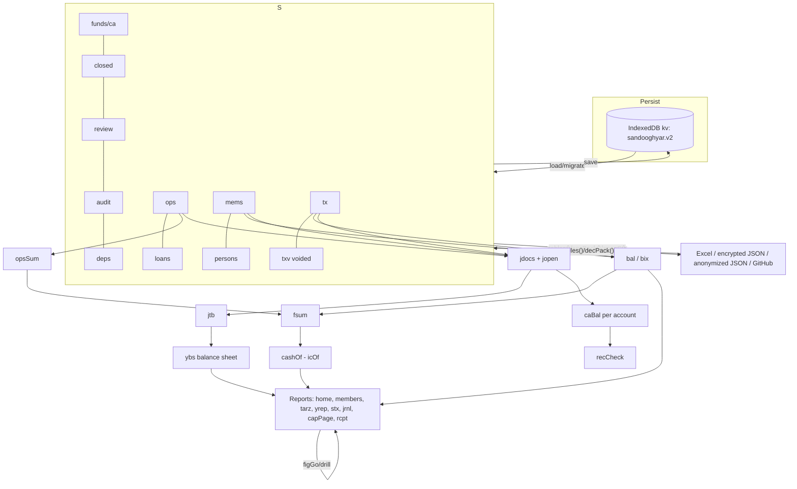

# 02 — Architecture and Code Map

## 1. Shape of the code

- One file, `index.html`.
  - CSS: L3–36.
  - Script: L38–1830, about 681 named top-level functions, no modules, no build-time bundling.
- **Global mutable state:**
  - `S`, the business data (doc 03);
  - `ui`, the transient UI state, partly persisted through `CFG.uk`;
  - `CFG`, device settings.
- **Global UI and runtime variables:**
  - sheet and history: `SK`, `SHS`, `HOPEN`, `HCL`, `TABH`, `TABBK`, `BACKTO`;
  - bulk-entry draft: `BV`, `BCK`, `BM`, `BUN`;
  - undo: `UNDO`, `LASTS`, `LREV`, `LTAP`;
  - edit and drill context: `OPREP`, `FMK`, `TDRX`;
  - caches: `BIX`, `PXC`, `LAX`, `CIX`, `HC`.
- **Rendering.** Every page is an HTML **string** built by concatenation and assigned with `innerHTML`. Event handlers are inline `onclick="…"` strings that call global functions. All user-originated text is supposed to pass through `esc()` (L58), which escapes `& < > "` but **not `'`** (see doc 05, SEC-05).
- **No framework.** No virtual DOM, no router library, no reactive store. A change triggers `save()` and then `draw()`, `pg(k)` or `fill()`, which re-render.

## 2. Major components

| Component | Responsibility | Key functions (line) |
|---|---|---|
| Storage shim | Map-backed key/value with IndexedDB persistence and localStorage fallback | `LS` L39–48, `LS.init` L1696 |
| State lifecycle | Load, validate, migrate, seed, save, snapshot, undo | `load` L80, `validState` L1217, `migrate` L713, `sanState` L994, `seed` L63, `save` L717, `snapshot` L725, `undoDo` L722 |
| Period model | Month index ↔ period key; current month; horizon | `pk`/`pix` L62, `curIdx` L592, `lastAll` L1687, `hz` L1690, `ml`, `MO` |
| Member ledger | Per-membership balances | `bal` L86 (+ `bix` index L85), `minBal` L1212, `loanRoom` L1213, `sugg` L648, `credit` L959 |
| Fund aggregates | Fund summary and cash | `fsum` L89, `opsSum` L650, `icOf` L653, `cashOf` L654, `osol` |
| Journal engine | Derives double-entry documents from `tx` and `ops` | `jdocs` L1161, `jopen` L1175, `jtb` L1176, `ybs` L1302, `caBal` L1273, `moinRows` L1282 |
| Entry workflows | Bulk entry, single transaction, corrections, transfers, closing account, fund events, vouchers, opening | `bulk`/`bsave` L352/381, `addTx`/`sub` L117/126, `corr` L558, `xferDo` L793, `mclose` L1031, `opForm`/`opSave0` L655/672, `jvForm` L1225, `applyOpening` L829 |
| Validation | Amount and date parsing, gap and lock checks, suspicion warnings | `an`, `vdate`, `gapErr` L625, `locked` L83, `susp` L629 |
| Reports | Pages and drill-downs | `home0` L107, `fill` L886, `tarz` L1096, `rep` L977, `yrep` L1307, `stx` L1402, `jrnl` L1177, `xfr` L788, `capPage` L850, `stmt` L1077, `rcpt` L1057, `drill` L1185, `tdr` L1207, `figGo` L1198 |
| Controls | Health, review, closing, audit | `health0` L1004, `rv` L278, `closev` L146, `audit` L987 |
| I/O | Excel, JSON, encrypted, anonymized, GitHub, print/PDF, share | `xl` L469, `tables` L422, `fromTables` L440, `encPack`/`decPack` L1506–1507, `anonS` L474, `cbk*` L1586–1613, `pdfOut` L1324, `shareOut` L1414 |
| Security | PIN, biometric, sealing secrets | `lk*` L1513–1540, `kdb`/`kOp` L1520–1521 |
| Navigation shell | Tabs, sheets, dialogs, back button | `draw` L103, `pg` L269, `sheet` L93, `lay` L96, `ask` L97, `note` L98, `hpop` L1124 |
| Optional | AI, sync, splash, messaging, queue | `ai*` L214–265, `rm*` L728–739, `splash` L1134, `rmd` L942, `lq` L962 |

## 3. Lifecycle

`LS.init()` → `boot()` (L1695; sequence in doc 00 §6).

**Per user action** (typical write):

```mermaid
sequenceDiagram
  participant U as User tap
  participant F as Form fn (e.g. bsave / sub / opSave0)
  participant V as Validation (an, vdate, gapErr, locked, susp, minBal)
  participant A as ask() review dialog
  participant S as State S
  participant P as save()
  U->>F: «مرور و ثبت»
  F->>V: validate inputs and future balances
  V-->>F: E-… error → note() and stop
  F->>A: summary and W-… warnings
  A->>S: on confirm: push tx/ops, txVoid old, audit()
  S->>P: save(): sanState, recCheck, rev++, JSON → LS, UNDO baseline, schedRemote, cbkSoon
  P-->>U: cl(); draw(); undoBar
```

- **Atomicity.** Most multi-record writes happen inside one synchronous callback before `save()`.
- `bsave` takes `SNAP=JSON.stringify(S)` and restores it if a post-condition fails (`E-EDIT`: a later month would go negative). Other workflows have no rollback; they validate first.

## 4. Data flow



## 5. Shared functions: change-impact map

Reference counts are textual call sites in `index.html`. They include calls inside generated `onclick` strings.

| Function | Approx. call sites | Used by | Risk if changed |
|---|---|---|---|
| `bal(mid,i)` L86 | 101 | Every report, validation, health, receipts, AI | **Critical.** Changes every number. Uses the `bix()` index (L85), which is cached per JS task and keyed by `tx` length, first/last id, `txv` length and `BIXN`. In-place edits of `mid` or `per` on existing tx would be missed. |
| `save()` L717 | 73 | Every write | **Critical.** Undo, sync, cloud backup, reconciliation staleness |
| `pg(k)` L269 | 171 | Navigation | High: routing of every page key |
| `ml(i)`, `pk`, `pix` L62 | 137+ | Period labels and keys | **Critical.** The period-key format `F1-1405-03` is persisted. `pix` is memoized (`PXC`). |
| `audit()` L987 | 72 | All writes | Medium. Hash chain format |
| `fsum` L89 / `opsSum` L650 / `cashOf` L654 / `icOf` L653 | 19 / 6 / 21 / 2 | Home, tarz, stx, closing, cash alerts, W-CASH, bulk review | **Critical.** Must stay equal to `ybs().cash` (health `H-JRNL-CASH`) |
| `jdocs` L1161 / `jopen` L1175 / `jtb` L1176 | 5 / 7 / 3 | Journal, trial balance, balance sheet, `caBal`, ledger, health, `opView` | **Critical.** Accounting truth for the balance sheet |
| `minBal` L1212 | 22 | Refund limits, edit rollbacks, `loanRoom`, `rclVoid` | High: future-negative protection |
| `lastAll` L1687 | 35 | Horizons, month lists | Medium (cached per task, `LAX`) |
| `curIdx` L592 | 20 | Current Jalali month (Intl persian) | Medium (60 s cache) |
| `sheet`/`lay`/`ask`/`note`/`cl` | 51/35/41/219/61 | UI | Medium: back-button behavior (`hsync`) |
| `esc` L58 | many | Every rendered string | **Security-critical** (doc 05) |
| `migrate` L713 / `validState` L1217 | 11/10 | load, restore, sync | **Critical.** Backward compatibility |
| `F`, `Fs`, `Rl`, `R` | very many | Formatting and rounding | Medium. Display rules (one decimal on summaries, exact on details) |

## 6. Error handling and logging

- **User errors** are shown with `note()`. Codes: `E-…` blocks the action; `W-…` warns and needs confirmation. Examples: `E-AMOUNT`, `E-DATE`, `E-LOCKED`, `E-PERIOD-GAP`, `E-EDIT`, `E-REFUND`, `E-CAP`, `E-ASSET`, `E-SHARE`, `E-DEPEND`; `W-CASH`, `W-DUP`, `W-FUTURE`, `W-INST`, `W-AMOUNT`, `W-UNIT`, `W-DATE`, `W-STATUS`.
- **Silent failures.** Many `try{…}catch(e){}` blocks swallow errors: storage, rendering helpers, sync, splash. No error telemetry or log is kept. A storage failure sets `ui.ns=1`, which shows a red banner on home.
- **Corrupt state.** `load()` copies an unparsable or invalid JSON to key `sandooghyar.v2.corrupt` and falls back to `seed()`. The user is not explicitly alerted (static reading; **untested**).
- **Business audit trail:** `S.audit` (doc 05).

## 7. Module boundaries and coupling

- Tightly coupled through globals: forms read DOM ids directly (`$('fo_a')`, `$('bs'+mid)`), and save callbacks capture closures.
- Reports call calculation helpers directly. There is no caching layer except the per-task index and memo caches.
- Feature flags (`mOn`) gate menus. The data structures of disabled modules still exist and are still computed (for example `deps` in bulk entry).
- Edit flows depend on hidden coupling. Examples:
  - `opEdit` pre-fills `opForm` DOM fields and sets `OPREP`;
  - `opSave` temporarily marks the old records void during validation;
  - `bsave` relies on `ed[].rep` and `NB` neighbors to re-insert replacements at the same position.

## 8. Technical debt and maintainability

| ID | Concern | Evidence |
|---|---|---|
| TD-01 | Single 638 KB file with about 681 global functions; very long one-line functions | Largest by span: `shareOut` (L1414, ~15 KB including following constants), `rst` L295 (~12.8 KB), `faq` L323 (~8.6 KB of guide text), `bsave` L381 (~8 KB), `fromTables` L440 (~8 KB), `tarz` L1096 (~6.7 KB), `opSave0` L672 (~4.9 KB), `aiDo` L242 (~5 KB), `jrnl` L1177 (~4.6 KB) |
| TD-02 | HTML built as strings with inline handlers; quoting is fragile | Many `'\''+id+'\''` constructs; `esc` does not escape `'` |
| TD-03 | Loan data duplicated in `S.tx` (type `loan`/`lrev`) and `S.loans` (`kind`, `term`, `rcv`, `void`) | `lvoid` L1026, `bsave`, `LN()` L1025. Risk of divergence. |
| TD-04 | Heuristic cache invalidation | `bix` key, `LAX`, `PXC`. Correct for current write paths, fragile for new ones. Call `bixTouch()` after in-place tx mutations. |
| TD-05 | Derived journal recomputed on demand (O(months×tx)) | Journal page ~1.2 s with 5.4k tx at 4× CPU throttle (VA) |
| TD-06 | Many page-specific UI state flags on `ui` | `tg, tv, tm, mg, sg, yg, jg, xg, cg, st, sf, so…` (some persisted) |
| TD-07 | Mixed languages in identifiers, terse names | e.g. `brec`, `bdef`, `fmo`, `fi`, `sub`, `ofi` |
| TD-08 | Guide text (`GUIDE`, FAQ, `WHATS_NEW`) embedded in code; must be updated by hand with each feature | `faq` L323 |
| TD-09 | Test harness depends on DOM stubs; browser checks are ad-hoc scripts that are not in the repo | `tests/`, `browser/` are private |
