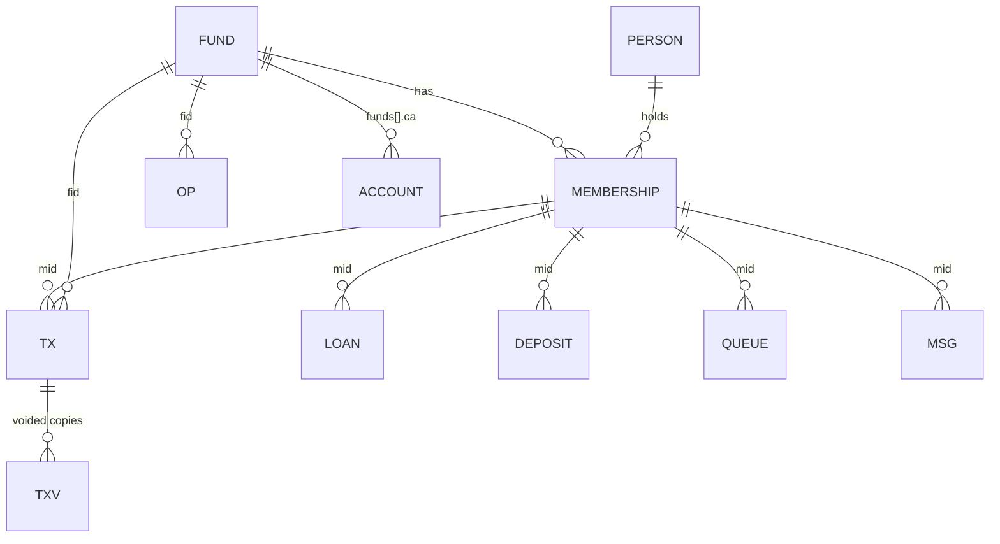

# 03 — Data Dictionary and Storage

There is **no database schema.** The app keeps one JavaScript object `S` in memory and persists it as one JSON string. Field lists below were extracted from object literals and assignments in `index.html` (static) and from the shape of the seeded state (executed). All examples are **synthetic**.

## 1. Storage technology and keys

### 1.1 Data storage

| Store | Name / key | Content | Written by |
|---|---|---|---|
| IndexedDB DB `sandooghyar` v1, object store `kv` | `sandooghyar.v2` | **Entire business state `S`** as JSON | `save()` L717 via `LS.setItem` |
| same | `sandooghyar.v2.cfg` | Device settings `CFG` (JSON) | `cfgSave()` L712 |
| same | `sandooghyar.v2.s1`, `.s2`, `.s3` | Rolling snapshots `{at, rev, json, label}`. `s1` is newest. Taken at boot if older than 6 h and every 25 saves. | `snapshot`/`snapObj` L724–725 |
| same | `sandooghyar.v2.corrupt` | Raw JSON that failed to parse or validate at load | `load()` L80 |
| localStorage (fallback mirror) | same keys | Used when IndexedDB is unavailable. `LS` shim, L39–48. | `LS` |

### 1.2 Secrets and per-device settings

| Store | Name / key | Content | Written by |
|---|---|---|---|
| localStorage | `sy.gh` | GitHub backup config: `{repo, auto, tok?, pass?}`. With the PIN lock on, `tok` and `pass` are removed and replaced by `sec` (AES-GCM sealed). | `ghWrite` L1498, `lkSeal` L1518 |
| localStorage | `sy.ai` | Gemini `{key, model, anon}` in **plaintext** | `aiSet` |
| localStorage | `miz.ai` | Read-only fallback key from the sister app «میز کار» | `aiMiz` |
| IndexedDB DB `sandooghyar-k`, store `k` | lock material | PIN-derived and biometric material | `kdb`/`kOp` L1520–1521 |

### 1.3 Session and caches

| Store | Name / key | Content | Written by |
|---|---|---|---|
| sessionStorage | `spl` | Splash already shown this session | `splash` |
| Cache Storage | `sandooghyar-v<VER>`, `sandooghyar-shell`, `sandooghyar-share` | App shell; CDN libraries and fonts | `sw.js` |

### 1.4 Persistence boundaries and risks

- Every `save()` rewrites the **whole** JSON. There is no incremental write.
- IndexedDB `put` is asynchronous and not awaited. A crash between `setItem` and the commit can lose the last write. **Untested.**
- `navigator.storage.persist()` is requested at boot. If it is denied, the browser may evict the data under storage pressure. The storage card shows the persistence status (L749).
- **Size.** About 81 members and about 100 transactions per quarter is small. The localStorage fallback has a ~5 MB quota. With 5.4k synthetic transactions the JSON was not measured; **untested**.
- **Data-loss scenarios:**
  - clearing site data;
  - uninstalling the PWA, which may clear its origin storage depending on the browser;
  - eviction when not persistent;
  - restoring an old backup, which replaces everything after confirmation.
- Mitigations exist: encrypted cloud backup, file backups, snapshots and a backup reminder.

## 2. Entity overview

## 3. Root object `S`

| Field | Type | Purpose | Notes |
|---|---|---|---|
| `v` | number | Schema marker (1) | No versioned migration steps; `migrate()` only fills missing collections |
| `c` | number | Counter for `nid(prefix)` (L61) | IDs are `prefix + 4+ digits`, e.g. `T0305`, `O0314` |
| `rev` | number | Incremented by every `save()` | Undo and sync concurrency |
| `funds[]`, `persons[]`, `mems[]`, `tx[]`, `txv[]`, `loans[]`, `ops[]`, `deps[]`, `review[]`, `audit[]`, `opens[]`, `queue[]`, `msgs[]` | arrays | Collections, documented below | `validState` (L1217) requires `funds`, `persons`, `mems`, `tx` and `loans` to be arrays with string ids |
| `closed` | object | `{[periodKey]: {locked, snaps[], reopens[]}}` | Month or year locks |
| `skips` | object | `{[periodKey]: {reason, at}}` | «بدون فعالیت» months |
| `ocat` | object | `{gift:[...], inc:[...]}` | User-defined titles for expense and income |
| `pmIgn` | string[] | Person pairs (`"P1|P2"`) marked "not the same person" | |

**Period key** (`pk`, L62) is `<fundId>-<year>-<MM>`, for example `F1-1405-03` (Khordad 1405).
- `pix(key)` returns the month index: `(year−1405)*12 + (MM−1)`.
- `i=0` is Farvardin 1405.

## 4. Collections

### 4.1 `funds[]` — صندوق

| Field | Type | Req | Purpose / example |
|---|---|---|---|
| `id` | string | ✓ | `F1` |
| `name` | string | ✓ | «صندوق نمونه»; `<` and `>` stripped by `sanState` |
| `multiLoan` | bool | | Allows more than one concurrent loan per member |
| `archived` | bool | | Archived funds are hidden from `AF()` |
| `al` | string[] | | Former names (aliases) |
| `ca` | object[] | | Cash and bank accounts `{id, name, kind:'cash'\|'bank', bank, num, own, def, dp, ar, sh?, rec[], recStale}` |
| `ca0` | string | | Default account id; legacy cash attaches here |
| `sm` | number | | Start month index of the fund |
| `dm`, `ms` | number | | Dormancy window in months (default 3, 0 = off); minimum monthly saving |

`num` and `own` hold a bank account number and owner name. They are **sensitive**, and `anonS` strips them.

### 4.2 `persons[]` — شخص

| Field | Type | Purpose |
|---|---|---|
| `id` | `P####` | |
| `name` | string | Full name |
| `g` | `'m'\|'f'` | Title «آقای / خانم» |
| `fa` | string | Father's name |
| `nid` | string | National ID (sensitive) |
| `ph`, `tels` | string, string[] | Phones (sensitive) |
| `acc` | string | Bank account or card (sensitive) |
| `addr`, `nt` | string | Address, note |
| `sn` | string | Short name used in messages |

### 4.3 `mems[]` — عضویت (membership; a person in one fund)

| Field | Type | Purpose / rules |
|---|---|---|
| `id` | `M####` | |
| `pid` | person id | Must exist (health `H-MEM-PERSON`) |
| `fid` | fund id | |
| `start` | string | Membership date (validated by `vdate`) |
| `status` | `فعال` \| `غیرفعال` \| `خارج‌شده` \| `متوفی` | |
| `os`, `ol` | number \| null | **Opening** savings and loan, in million toman, at the start of 1405 or the fund start |
| `qs` | number \| null | Agreed monthly installment from Excel; used by `sugg` |
| `note` | string | |
| `succOf`, `rel`, `succDate`, `succNote` | | Succession link to a deceased member |

### 4.4 `tx[]` — تراکنش عضو (member transaction)

| Field | Type | Purpose |
|---|---|---|
| `id` | `T####` | |
| `type` | enum | `sav`, `inst`, `loan`, `credit`, `ref`, `refc`, `inj`, `injret`, `rcl`, `xout`, `xin`, `lrev` (labels in `TY`, L56) |
| `amt` | number > 0 | Million toman (R7) |
| `fid`, `mid`, `per` | ids, period key | |
| `date` | `'1405/03/15'` \| null | Optional Jalali date |
| `at` | ISO time | Creation time |
| `note`, `src` | string | Source: `bulk`, `correction`, `transfer`, … |
| `ca` | account id | Cash or bank account used |
| `trk` | string | Bank tracking number |
| `term`, `rcv`, `rph`, `rsm` | loan only | Installments, real receiver name and phone, send reminder to receiver |
| `rp` | 0 \| 1 | For `inj`: 0 = donation (بلاعوض), otherwise refundable |
| `from`, `to` | `sav`\|`inst`\|`credit` | For `rcl` (correction) |
| `cp`, `bk`, `xid` | | For `xout`/`xin`: counterpart membership, bucket (`sav`/`credit`/`loan`), pair id |
| `dep` | deposit id | Linked announced deposit |
| `ref` | review id | Correction created from a review item |
| `rno`, `prev`, `rv` | | Stable receipt number across edits; previous version id; revision count (0.39.1+) |

### 4.5 `txv[]` — تراکنش‌های باطل‌شده (voided transactions, persistent history)

A copy of the tx plus `vr` (reason) and `vat` (time). Created by `txVoid(L,why)` (L380), which **removes the record from `tx`**, unlinks deposit allocations, and audits the void.

### 4.6 `loans[]` — وام (loan metadata; parallel to `tx` type `loan`)

`{id:'L####', fid, mid, amt, per, kind:'جدید'|'افتتاحیه', term, rcv, rph, rsm, date, sd, void, vr}`. `LN()` (L1025) excludes void loans. **Duplication risk:** see doc 02, TD-03.

### 4.7 `ops[]` — رویداد مالی صندوق (fund-level event)

| Field | Purpose |
|---|---|
| `id` `O####`, `type` | `ctr`, `gift`, `inc`, `cap`, `capret`, `dep`, `wd`, `buy`, `sell`, `jv` (`OPT`) |
| `fid`, `per`, `amt`, `date`, `at`, `note`, `trk` | |
| `ca`, `ca2` | Source account and destination account (`ctr`) |
| `cat` | Title for gift and income |
| `asset`, `cost` | Asset name; cost of the part sold (`sell`) |
| `src`, `spid`, `rp` | Investor name, investor person id, refundable (≠0) or donation (0) for `cap`/`capret` |
| `gid` | Shared operation group across funds |
| `rc` | Gift distribution `[[mid, amount], …]` |
| `ln`, `jk`, `no` | For `jv`: lines `[account, debit, credit, cashAccountId?]`; kind `gen`\|`oc` (opening cash)\|`sus` (suspense); voucher number |
| `void`, `vr` | Voided flag and reason. Voided ops stay in `ops`; they are not moved. |
| `rno`, `rv`, `rto` | Stable document number across edits, revision, and "replaced by" marker on the old record (0.40.0+) |

### 4.8 Other collections

| Collection | Fields | Notes |
|---|---|---|
| `deps[]` — واریزی اعلام‌شده | `{id:'D…', fid, mid, name, amt, date, ca, trk, note, at, al:[{tx, a}], void, vr}` | `depRem(d) = amt − Σal.a` |
| `review[]` — موارد بررسی | `{id:'R…', kind, fid, mid, per, status:'نیازمند بررسی'\|'اصلاح‌شده'\|'تأییدشده', src:{sheet, cell, excel}, app, msg, res, resNote}` | Effective status is derived live (`rvSt` L524) |
| `audit[]` | `{t:ISO, a:action, d:detail, h:fnv-hash}` | Newest first (`unshift`); hash chained to the previous `h` |
| `opens[]` | `{id:'D…', fid, date, reason, at, items}` | Opening-balance change documents (`applyOpening` L829) |
| `queue[]` | `{id:'Q…', mid, amt, note, at, status:'در صف'\|…, lot}` | Loan queue |
| `msgs[]` | `{id:'G…', t, mid, ty, per, ch, n[], who:'m'\|'r', grp, st}` | Message log, capped at 5,000 |

## 5. Device settings `CFG` (key `sandooghyar.v2.cfg`)

Observed keys: `sync, lb` (last backup), `ch` (changes since backup), `bh` (sync hash), `lrev`, `dev`, `base`, `cbk` (cloud backup status), `bk2`, `lk` (lock config, `lk.wp`), `off` (modules), `theme`, `spl` (splash), `uk` (remembered filters), `wnSeen`, `tpl`/`tpls`/`gtpls` (message templates), `sent`, `gsz`, `mch`, `emg`, `drill`, `nqOff`, `safeS`, `tried`. These are not part of backups of `S` (static reading).

## 6. Derived (non-persistent) values

Balances, cash and the journal are **always recomputed**:
- `bal`, `fsum`, `opsSum`, `cashOf`, `icOf`;
- `jdocs`, `jopen`, `jtb`, `ybs`, `caBal`;
- `capRows`, `capSum`, `capOf`, `rvSt`, `health`.

Caches: `BIX` (per-member tx index), `PXC` (period index), `LAX` (`lastAll`), `CIX` (`curIdx`, 60 s), `HC` (health).

## 7. Migration, validation, deletion

- `migrate(o)` (L713):
  - adds missing arrays and objects;
  - runs `sanState` (strips `<` and `>` from names and notes);
  - back-fills `mems.qs` from the `D` constant, which is empty in the public build.
- There are no numbered schema migrations. New optional fields are read defensively, for example `o.ops||[]` or `x.rno||x.id`.
- **Deletion policy.** Business records are not hard-deleted:
  - transactions are voided into `txv`;
  - ops and loans are flagged `void`;
  - review items change status.
- **Hard deletes** that exist:
  - fund deletion, `fDel` L549. Confirmation is required. The exact cascade to its members was **not verified**.
  - person merge, which rewrites `mems.pid` and removes the merged person (static);
  - restore, which replaces the whole state.
- **Referential-integrity checks:** `health0` (L1004) reports codes such as `H-DUP-ID`, `H-MEM-PERSON`, orphan tx, broken transfer pairs, negative balances, and journal mismatches (`H-JRNL-LOAN`, `H-JRNL-CASH`).

## 8. Backup formats

| Format | Producer → consumer | Content | Confidentiality |
|---|---|---|---|
| Encrypted JSON `*.enc.json` | `encPack` L1506 → `decPack` L1507 | `{app:'SandooghYar', v:1, kdf:'PBKDF2-SHA256', it:150000, alg:'AES-GCM-256', z:gzip?, salt, iv, ct, at, ver, n:{f,m,t}}`. Plaintext is `{app, ver, at, data:S}`. | Password-based (≥ 8 chars) |
| Excel `.xlsx` | `tables` L422 → `fromTables` L440 | One sheet per collection, including `Meta`, `VoidedTx`, `Messages`, … | **Plaintext** (the UI warns about this) |
| JSON `.json` | `jsBackup` L483 → `rFile`/`rst` | `{app, ver, at, data:S}` | Plaintext |
| Anonymized JSON | `anonS` L474 | `S` with names replaced by `شخص1…`, sensitive keys dropped, and digit runs of 8 or more masked as `•••` (except id, period and date keys) | Designed to be shared; **not restorable** |
| GitHub | `cbk*` | Encrypted pack committed as a file version to the user's private repo | Token in `sy.gh` |

**Restore behaviour:**
- detects the format (encrypted, Excel or JSON);
- runs `validState(migrate(...))`;
- asks for confirmation, then replaces `S` entirely;
- the previous state is kept only through snapshots and undo.
