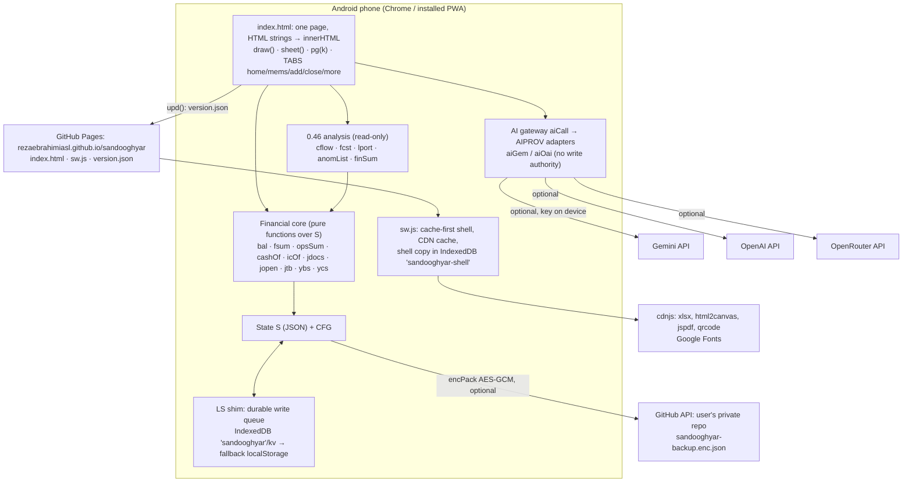
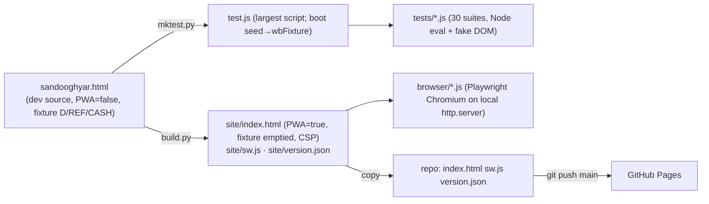

# 14 — Architecture map (0.46.0, commit 750ac84)

Extracted from the dev source `sandooghyar.html` (2014 lines, ~730 functions). Line ranges are approximate (±5) and drift with edits; search by function name.

## 1. Runtime picture

## 2. Build and test pipeline

`runall.sh` runs build → mktest → unit → browser (smoke, recovery, idbfail, idbdur, syncinteg, xlroundtrip, csp, upgrade vs repo HEAD, offline).

## 3. Boot sequence

1. `LS.init()` opens IndexedDB. If it fails: `IDBF=true`.
2. `boot()`:
   - `cfgLoad`, `applyTheme`, `splash`, `prevMigrate`.
   - `S=load()`:
     - if this returns nothing but a raw value exists: `RCV='corrupt'`, nothing is written;
     - if it returns nothing and the store is empty: `seed()` creates empty funds and saves them.
   - If `IDBF`: `RCV='idb'` (read-only).
3. Restore UI filters from `CFG.uk`.
4. `snapshot()` (unless in recovery), `ui.p=defP()`, `draw()`.
5. Lock screen if `CFG.lk`; recovery sheet if `RCV`.
6. `hstart`, then `upd()` (SW registration and version check).
7. `rmStart()` (claude.ai sync, only in artifact mode), `wnCheck()` ("what's new"), `navigator.storage.persist()`.
8. Background hooks:
   - visibility hidden → `persistNow`;
   - online → `LS.retry`;
   - `beforeunload` guard while writes are pending;
   - PWA: `cbkAuto` after 8 s, then every 30 min.

## 4. Code map (dev source line ranges)

| Lines | Area | Key functions |
|---|---|---|
| 1–100 | constants, fixture | `KEY`, `FUNDS`, `D`, `REF`, `CASH`, `TY`, `R/F/Fs/Rl`, `seed`, `wbFixture` |
| ~20 | storage shim | `LS` (IIFE): `init`, `getItem`, `setItem`, ticket, `flush`, `retry`, `state`, `clean`, `onChange`, `idb` |
| 101–200 | load, member balances, shell UI | `load`, `bix`, `bal`, `fsum`, `sheet`, `cl`, `ask`, `note`, `draw`, `home`, `detail`, `addTx` |
| 201–300 | month close, **0.46 analysis**, reports | `closeIt`, `reopen`, `cflow`, `fcst`, `lastPay`, `lport`, `anomList`, `finSum`, `fcstPg`, `anomPg`, `lportPg`, `aiInsight`, `reps`, `vdoc`, `alrItems`, `alr` |
| ~293 | **AI gateway** | `AIPROV`, `aiCall`, `aiOai`, `aiGem` |
| 301–400 | assistant, router | `aiMap`, `aiHide`, `aiShow`, `aiOpen`, `aiSetup`, `aiSave`, `aiRun`, `aiDo`, `aiFill`, `pg` |
| 401–500 | guide, org, add menu, bulk entry | `gOpen`, `faq`, `orgBox`, `addPage`, `bulk`, `bsave` |
| 501–600 | Excel / JSON backup | `tables`, `fromTables`, `xl`, `xlBackup`, `anonS`, `xlRestore`, `opExport`, `opImp` |
| 601–700 | review hub, funds | `rvFix`, `rvSt`, `fnd`, `fNew`, `fEdit`, `fArc`, `fHist`, `fDel*` |
| 701–800 | loans, fund operations | `loanEst`, `loanBlock`, `sugg`, `opsSum`, `icOf`, `cashOf`, `opForm`, `ofi` |
| 801–900 | save, undo, snapshots, claude.ai sync | `migrate`, `recCheck`, `save`, `undoDo`, `snapObj`, `snapRestore`, `rm*`, `shash` |
| 901–1000 | dates, opening, capital injection | `jLeap`, `vdate`, `opn`, `applyOpening`, `capBal`, `capPage`, `capLed` |
| 1001–1100 | deposits, queue, reminders | `smsParse`, `depAdd`, `depVoid`, `depRep`, `qAdd`, `qIssue`, `qCancel`, `rmd`, `credit` |
| 1101–1200 | health, receipts, statements | `health0`, `hlt`, `ledger`, `numWords`, `balTx`, `rcpt`, `stmt` |
| 1201–1300 | global search, theme, persistence UI, journal | `aiAsk`, `gsx`, `okToast`, `persistFail`, `persistNow`, `psiUpd`, `jopen`, `jtb`, `jdocs` (~1290) |
| 1301–1400 | manual journal (jv), opening cash | `validState`, `jvForm`, `jvSave`, `ocForm` |
| 1401–1500 | lottery, balance sheet, **year-end** | `lotGo`, `ybs`, `ycs`, `ycDoc`, `ycCard`, `yrep`, `prt`, `pdfOut` |
| 1501–1600 | charts, sharing | `stx`, `chBars`, `chLines`, `shareOut` |
| 1601–1700 | encryption, GitHub, lock | `ghCfg`, `ghSet`, `encPack`, `decPack`, `gh`, `lk*`, `kdb` |
| 1701–1800 | multi-device, cloud backup | `devN`, `cbkSoon`, `cbkPeek`, `cbkLink`, `lnkAsk`, `safeCard`, `bk2`, `cbkAuto`, `cbkUp`, `cbkSmall` |
| 1801–1900 | search, cash accounts, recovery, boot | `caRec`, `caEdit`, `dorm*`, `ml`, `lastAll`, `rcvShow`, `rcvFresh`, `rsAsk`, `rsInteg`, `boot` |
| 1901–2014 | messages, contacts, voice, all-funds home | `msgCard`, `ctim`, `vOpen`, `micGo`, `nqSave`, `homeAll` |

## 5. Extension rules (how to add a feature without breaking the core)

- New pages:
  - write `fooPg()` returning an HTML string;
  - add `foo:fooPg` to the map in `pg()`;
  - add a tile in `reps()`;
  - if it is optional, add an entry to `MODS` and filter with `mOn`.
- New stored fields:
  - give them a default in `migrate`;
  - add them to `tables()` and `fromTables()` (the Excel round-trip must stay `ndiff 0`);
  - check whether `rsInteg` should treat them as blocking.
- New AI provider: add an entry to `AIPROV` (`name`, `base`, `call`, `models`) and the host to CSP `connect-src` in `build.py`.
- Never call `save()` from analysis or AI code. Financial writes go only through the existing forms (`bsave`, `opsave`, `jvSave`, `depAdd`, …), which take audit and undo.
- Every change needs synthetic-data tests in `tests/` and a full `./runall.sh`.
